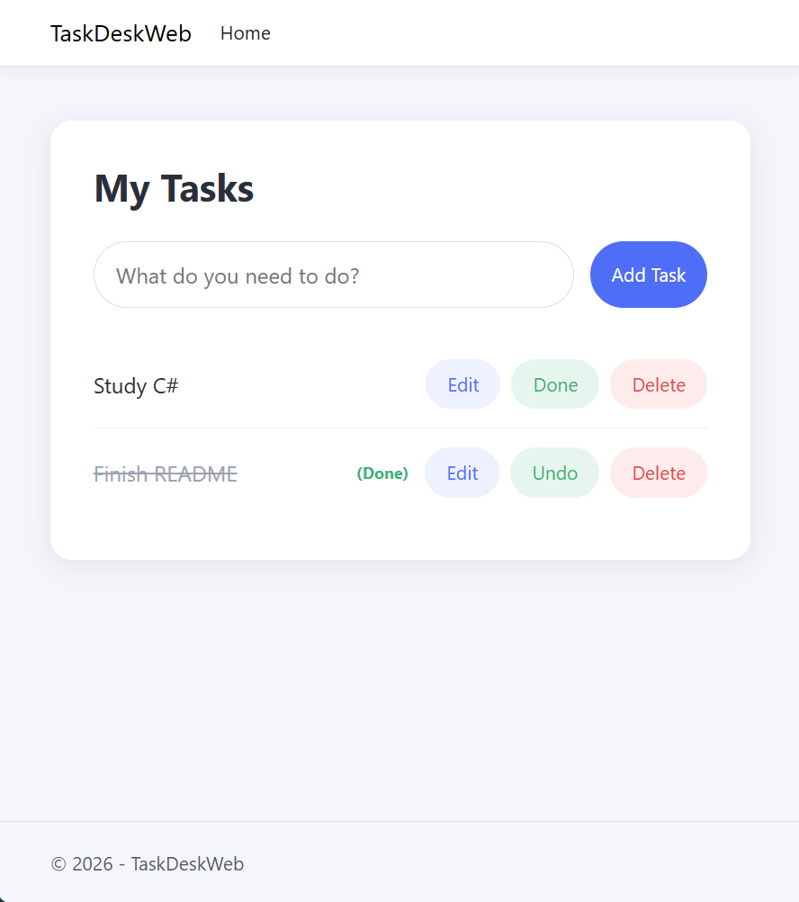
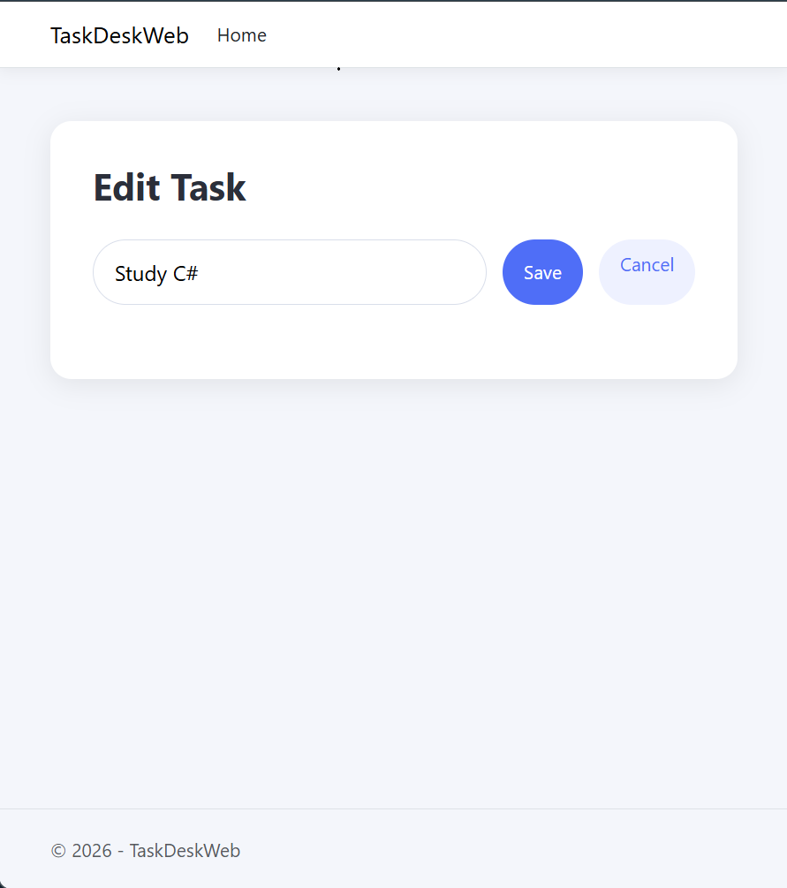

# TaskDeskWeb

A simple task manager web application built with C# and ASP.NET Core Razor Pages. It is the web version of my final-year desktop project, MyTaskDesk.

## Features

- Add a new task
- View all saved tasks
- Mark a task as done, and undo it
- Edit a task's title
- Delete a task
- Tasks are saved permanently in a SQL Server database

## Technologies Used

- C# and .NET
- ASP.NET Core Razor Pages
- Entity Framework Core
- SQL Server (LocalDB)
- HTML and CSS
- Git and GitHub

## Screenshots





## How to Run

1. Install the .NET SDK (the version shown in `TaskDeskWeb.csproj`).
2. Install SQL Server LocalDB (it is included with Visual Studio).
3. Clone this repository:

```
git clone https://github.com/eugeneekong08-hash/TaskDeskWeb.git
cd TaskDeskWeb
```

4. Run the application:

```
dotnet run
```

5. Open the address shown in the terminal. The database is created automatically on the first run.

## What I Learned

- How a web request travels from the browser to the database and back
- Entity Framework Core and the DbContext
- Dependency injection in ASP.NET Core
- Building the four basic data operations (Create, Read, Update, Delete)
- Styling a page with CSS

## Planned Improvements

- Due dates, priorities and filtering
- Task and expense categories
- User registration and login
- Database migrations

## Author

Ekong Emediongabasi Eugene
